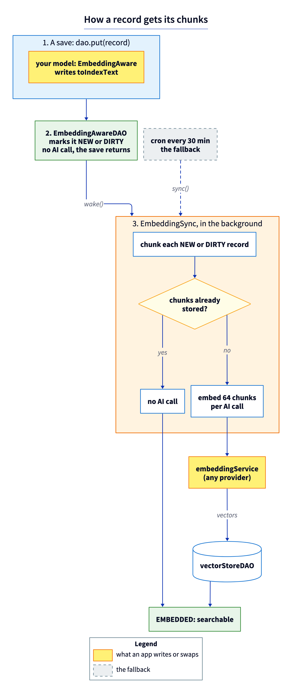
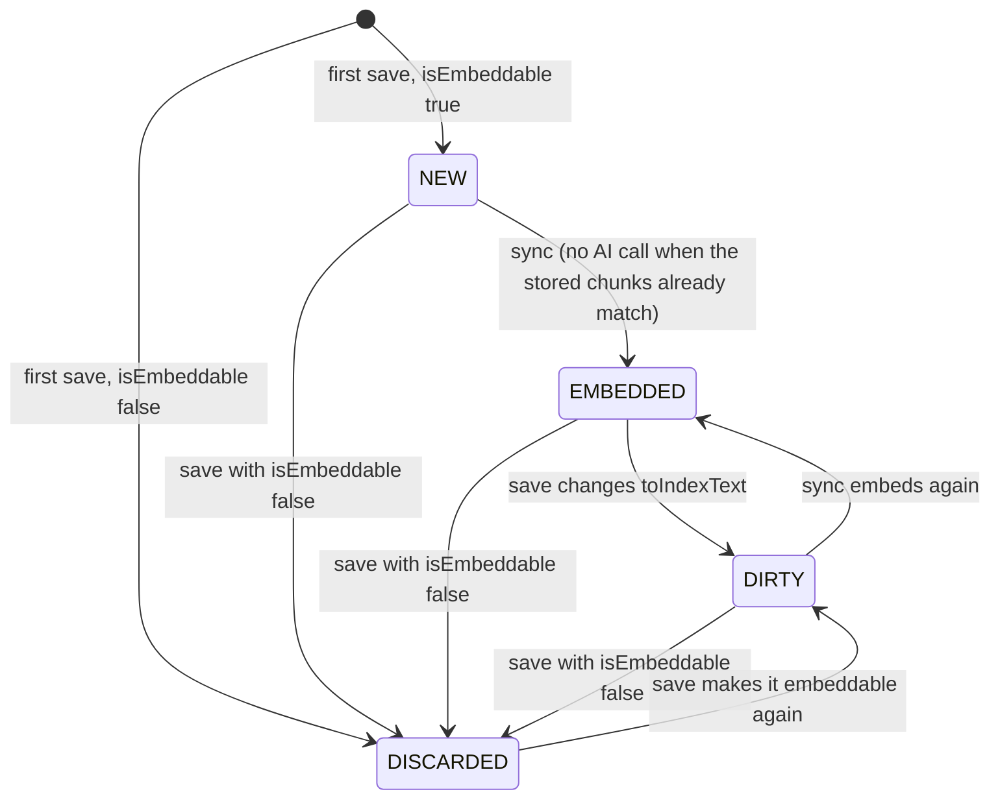
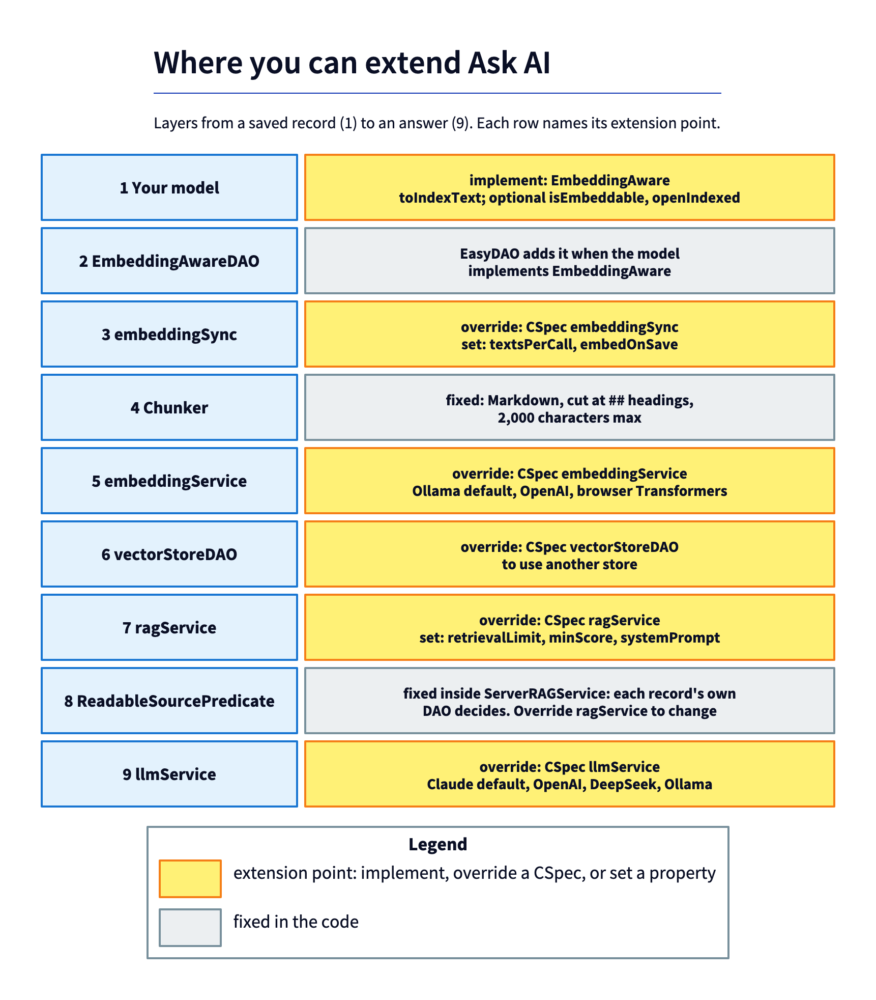
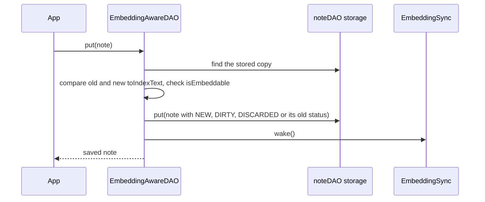
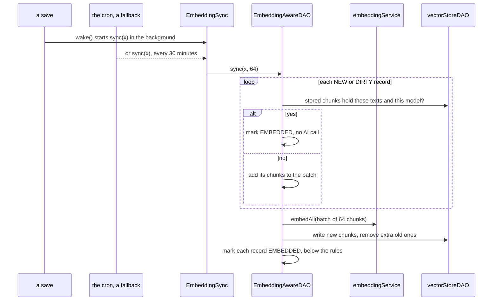
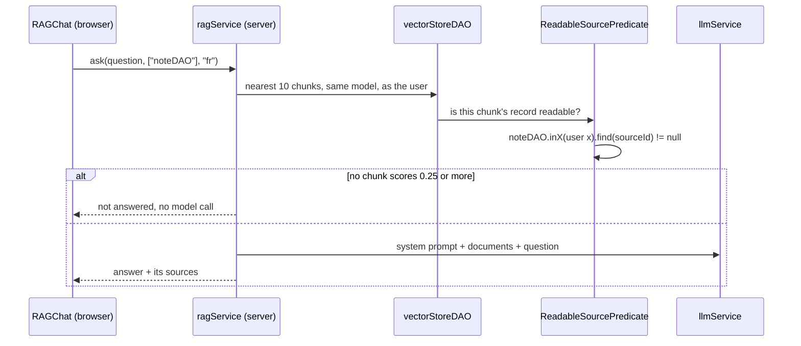
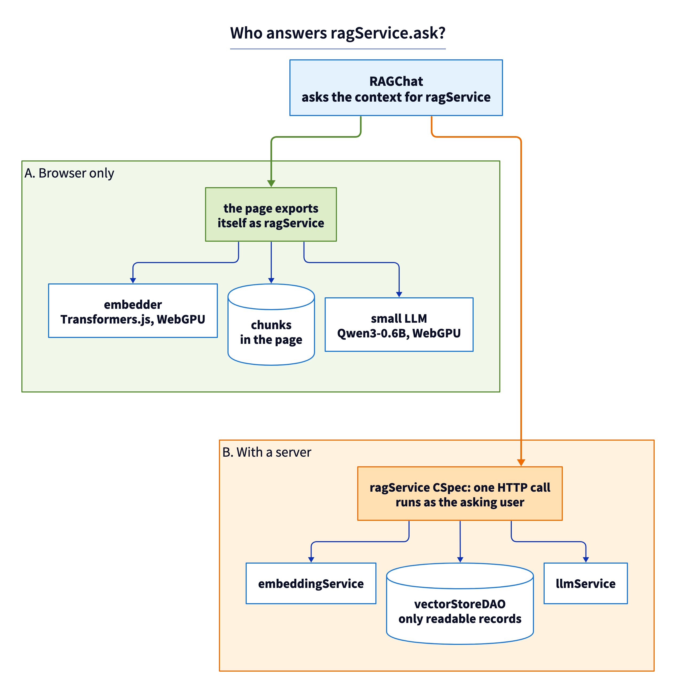

<!-- cspell:ignore spid daoKey daoKeys sourceId embeddingModel storageTransient CosineComparator kNN Ollama Xenova Chunker ragService llmService embeddingService vectorStoreDAO noteDAO EasyDAO nSpec isEmbeddable toIndexText openIndexed embeddingSync textsPerCall embedOnSave MDAO MiniLM Qwen cronjobs -->
<flow name="EmbeddingsArchitecture" category="DOC/ARCHITECTURE" spid="foam" description="The design of EmbeddingAware: the cases it handles, its components, how a save, a sync, a boot and a question run, browser versus server, the choices made and what they cost, with memory and search numbers." keywords="vector,embedding,rag,architecture,EmbeddingAware,EmbeddingStatus,EmbeddingSync,ragService,ReadableSourcePredicate"/>

# Embeddings: Design and Architecture

How `EmbeddingAware` keeps a model's records searchable by meaning, and why it is built this way. To use it, read the guide instead: [Embeddings](../guides/Embeddings.md).

## 1. The problem

Vector search finds a record by meaning ([Vector Search](../guides/VectorSearch.md)). Its vectors have to follow the records:

- a new record needs vectors;
- an edited record needs new vectors, and its old ones must go;
- a deleted record must leave the index;
- a record the user cannot read must never feed an answer.

Before this, each app wrote that itself: a rule to index, a hash to spot changes, and an access check at search time. Now the model implements one interface and the framework does the rest.

## 2. The design in one picture

1. **The model says what text it has**, through `toIndexText`.
2. **A save marks the record**: `EmbeddingAwareDAO` sets `embeddingStatus` and makes no AI call.
3. **The save starts the sync** in the background. `EmbeddingSync` embeds every `NEW` and `DIRTY` record, the chunks of many records in one call.
4. **The cron is the fallback**: every 30 minutes it runs the same sync, for what a save could not embed.
5. **A question searches as the user**: `ragService` keeps only chunks whose record the user can read.

## 3. The cases

| Case | What happens |
|---|---|
| New record | `NEW`. The sync embeds it a moment later. |
| Edit that changes `toIndexText` | `DIRTY`. The sync embeds it again and removes every old chunk, so a shorter text leaves none behind. |
| Edit that leaves `toIndexText` as it was | The status stays. No AI call. |
| `isEmbeddable` turns false, e.g. a note made private | `DISCARDED`. The save removes its chunks at once. |
| Remove | The record and its chunks go in the same call. Remove is not a status. |
| Edit while the sync embeds it | The new status wins, so the next sync embeds the new text. |
| Server start | Every record is `NEW`, since the status is not stored. The sync compares chunk texts: an unchanged record becomes `EMBEDDED` with no AI call. |
| Record dropped from a journal while the server was down | The first sync after the start removes its chunks. |
| Provider down | Records stay `NEW` or `DIRTY` with their old chunks. One warning, and the next sync retries. |
| One text the provider refuses | That record is skipped with a warning; the others of its call are embedded. |

## 4. Components

| Component | Role | File |
|---|---|---|
| `EmbeddingAware` | The interface: `toIndexText`, `isEmbeddable`, `openIndexed`, and the `embeddingStatus` property (`storageTransient`). | `src/foam/ai/vector/EmbeddingAware.js` |
| `EmbeddingAwareDAO` | Sets the status on a put, removes chunks on a discard or a remove, wakes the sync. Its `sync` embeds this DAO's `NEW` and `DIRTY` records. | `src/foam/ai/vector/EmbeddingAwareDAO.js` |
| `EasyDAO.embeddingAware` | Adds the decorator when `of` implements `EmbeddingAware`, as `LifecycleAware` adds `LifecycleAwareDAO`. It sits below the rules, so the sync's status write runs no rule. | `src/foam/dao/EasyDAO.js` |
| `EmbeddingSync` | Holds every `EmbeddingAwareDAO` that registered itself when built. `wake()` runs one sync at a time in the background. | `src/foam/ai/vector/EmbeddingSync.js` |
| `embeddingSync` cron | The fallback: `sync()` every 30 minutes. | `src/foam/core/ai/cronjobs.jrl` |
| `RAGIndexer` | Cuts text into chunks, embeds them, replaces the old ones. Spots unchanged chunks by comparing texts and the embedding model. Chunk ids are `<daoKey>:<sourceId>:<n>`, e.g. `noteDAO:42:0`. | `src/foam/core/ai/vector/RAGIndexer.js` |
| `VectorStoreDAO` | Holds the chunks and answers a cosine `orderBy` by scanning a packed `float[]`. | `src/foam/ai/vector/VectorStoreDAO.js` |
| `ReadableSourcePredicate` | Keeps a chunk only when the user can find its record through that record's own DAO. | `src/foam/core/ai/vector/ReadableSourcePredicate.js` |
| `ragService` | `ask(x, question, daoKeys, locale)`: embeds the question, searches as the user, asks `llmService`, returns the answer and its sources. | `src/foam/core/ai/llm/ServerRAGService.js` |
| `RAGChat`, `RAGChatPanel` | The chat view. It calls only `ragService`, so it is the same in the browser and on a server. | `src/foam/ai/llm/RAGChat.js` |

## 5. How it runs

### Save: no AI call

A provider that is down cannot fail a save. The chunks of a discarded record are removed as the system, so a user who may edit a record needs no right on `vectorStoreDAO`.

### Sync: many records in one call

The sync runs as the system; access is checked when someone asks. The status write adds no journal line, history row or last-modified date, since the status is not stored and the write goes below the rules.

### Ask: as the user

The browser never sees the system prompt or the provider's key.

## 6. Browser or server

`RAGChat` only asks its context for `ragService`. Whoever puts it there decides where the work runs.

| Piece | Server | Browser only |
|---|---|---|
| The model | Implements `EmbeddingAware` | The same |
| Marks changes | `EmbeddingAwareDAO`, Java | `EmbeddingAwareDAO`, JS |
| Runs the sync | A save, and the cron every 30 minutes | The same `EmbeddingSync`, 1 second after a change |
| Makes vectors | `embeddingService`, any provider | Transformers.js on WebGPU (`Xenova/all-MiniLM-L6-v2`) in a Web Worker |
| Writes answers | `llmService` | Transformers.js (`onnx-community/Qwen3-0.6B-ONNX`) in a Web Worker |
| Who sees what | Only records the user can read | Whatever the page holds |

## 7. Choices and their costs

| Choice | Gives | Costs |
|---|---|---|
| Compare chunk texts, no stored hash | No extra field; seed files carry no hash. | A `NEW` record is chunked again and its chunks are read, with no AI call. |
| Status not stored | The sync's status writes add no journal line. | After a restart, one text-compare pass over every record. |
| Decorator below the rules | The status write runs no rule and adds no history row. | A rule cannot react to a record turning `EMBEDDED`. |
| Hard remove | Remove keeps its meaning on every model. | A record added again is embedded again. |
| No AI call on save | Saves stay fast; an outage fails no save. | An edit is searchable seconds after the save, not at once. |
| 64 chunks per call | 20,000 records of about 3 chunks took 910 calls, not 20,000. | A refused text fails its call, so its records are retried one by one. |
| DAOs register when built | No list of DAOs to keep in step. | A DAO built on first use joins the sync only then. |
| Access checked at ask time | One index serves every user. | Each search looks up the record of every chunk that scores 0.25 or more. |
| Exact search in memory | Always the true nearest chunks; no index to tune. | Memory and time grow with the chunk count (below). |

## 8. Numbers

`VectorStoreMemoryBenchmark`, chunks of 800 characters, a search for the 10 nearest:

| Chunks | Vector size | Memory per chunk | First search | Later searches |
|---|---|---|---|---|
| 1,000 | 1536 | 15.7 KB | 11 ms | 5 ms |
| 10,000 | 1536 | 13.7 KB | 52 ms | 10 ms |
| 100,000 | 1536 | 13.5 KB | 458 ms | 95 ms |
| 100,000 | 384 | 4.2 KB | 111 ms | 23 ms |

`VectorStoreSearchBenchmark`, the search `ragService` makes, 1% of chunks close to the question:

| Chunks | Records the user can read | Records looked up | Search |
|---|---|---|---|
| 100,000 | all | 10 | 16 ms |
| 100,000 | 1% | 992 | 17 ms |
| 100,000 | none | 992 | 16 ms |
| 1,000,000 | none | 32,128 | 31 ms |

Only chunks at or above `minScore` are looked up, so the lookups follow how many chunks are close to the question, not the size of the store. The million-chunk row uses 64-number vectors, whose random scores pass 0.25 more often than a real model's.
