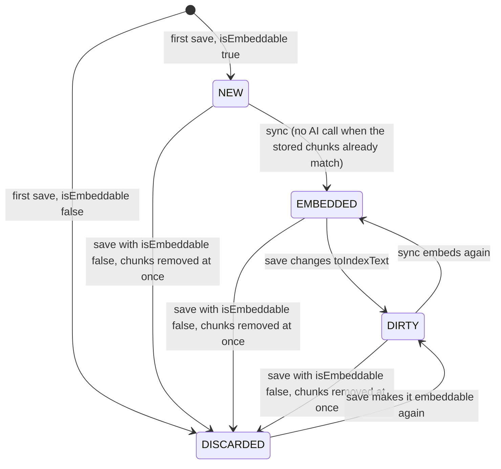
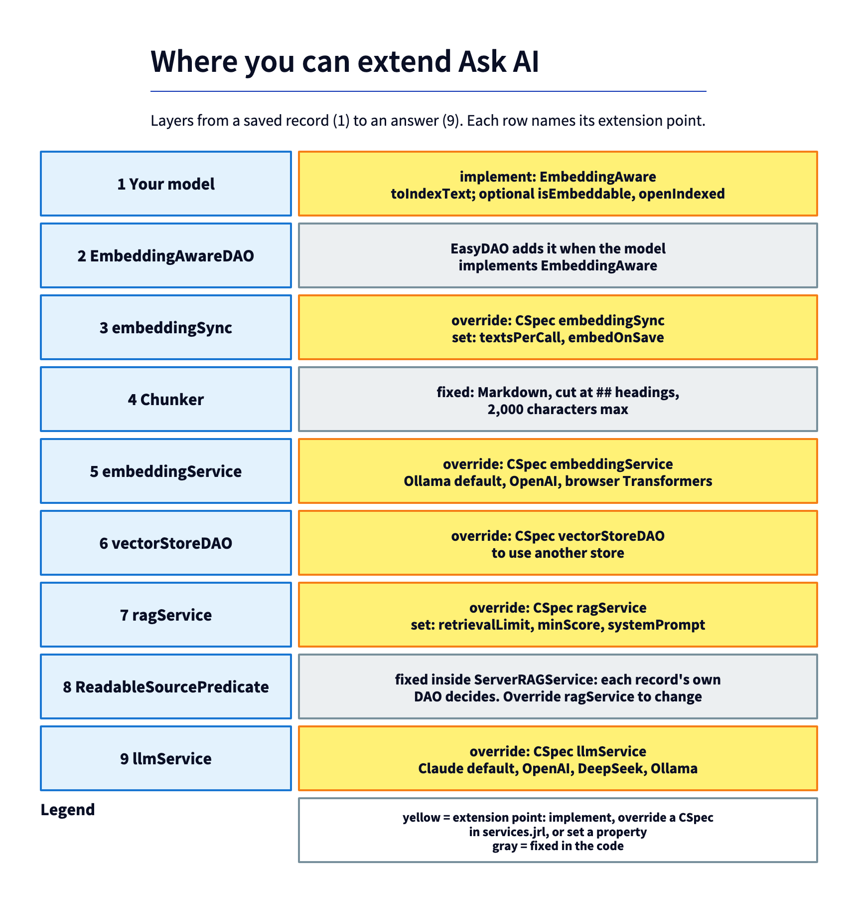
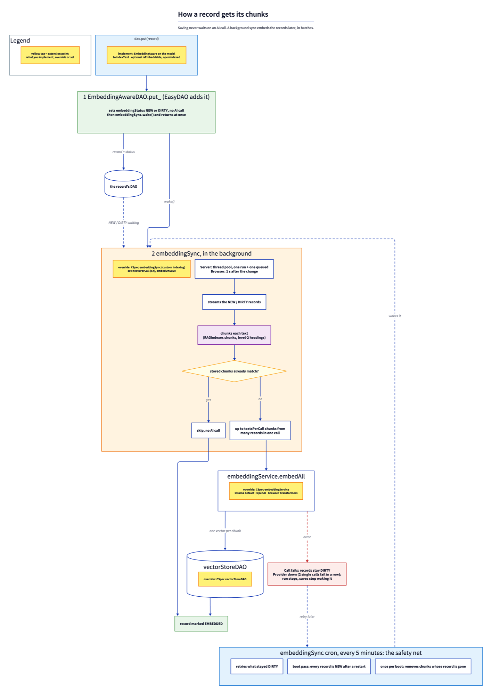
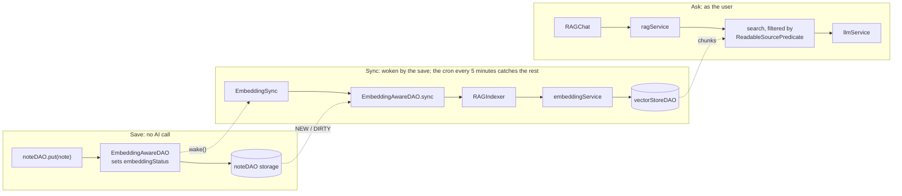
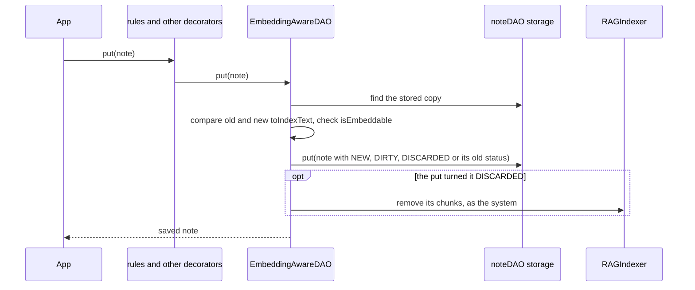
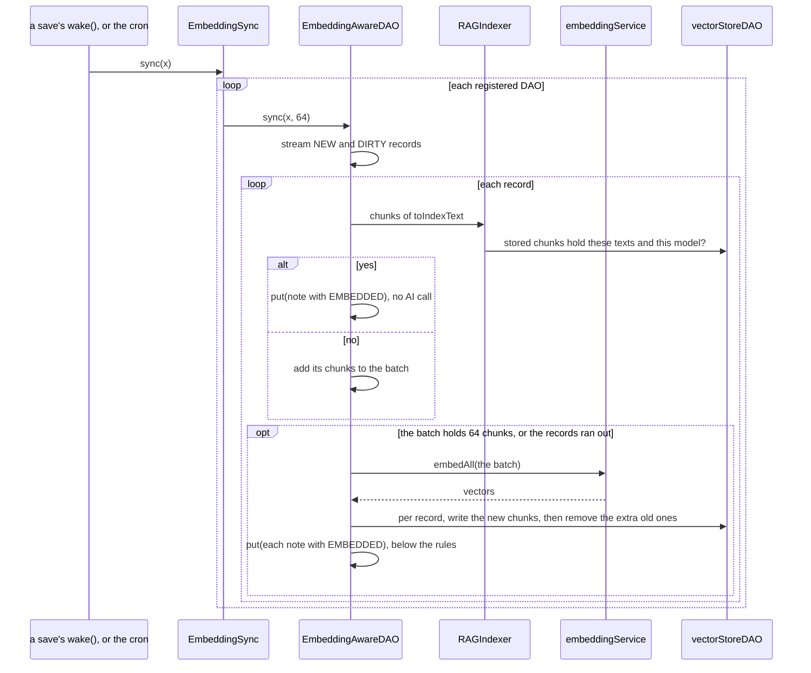
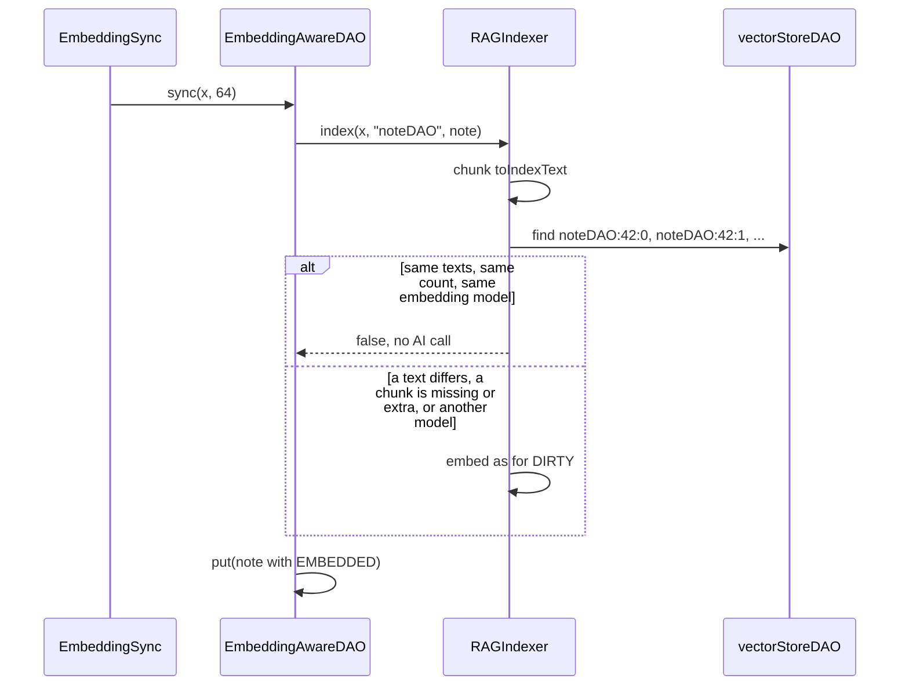
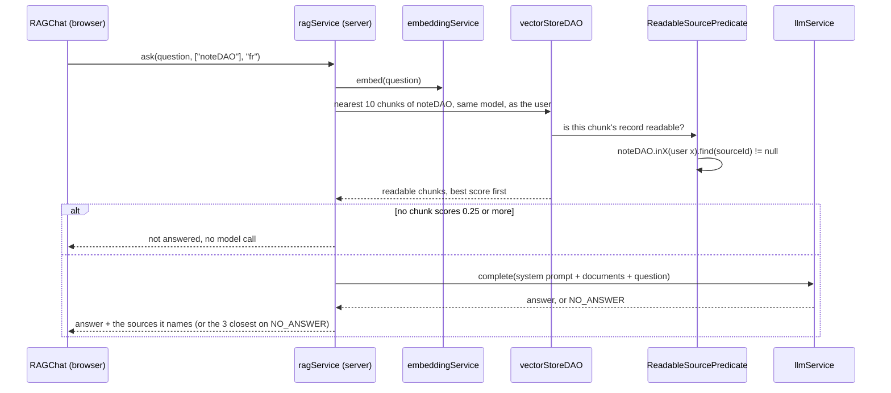
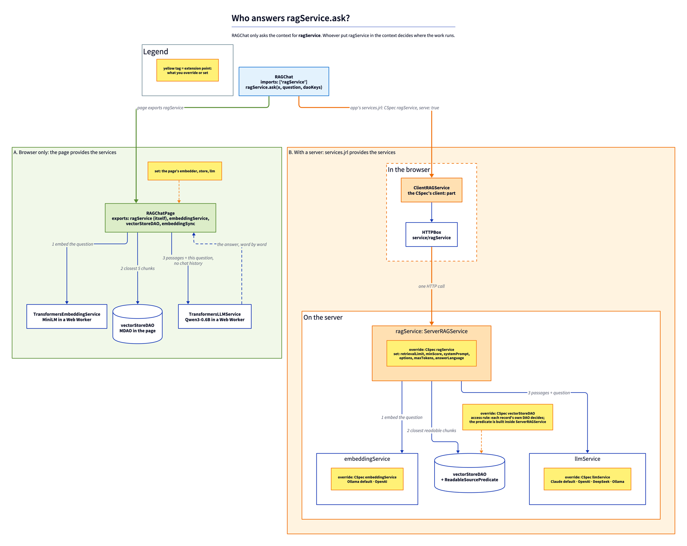

<!-- cspell:ignore spid daoKey daoKeys sourceId embeddingModel storageTransient CosineComparator kNN Ollama Xenova Chunker chunker ragService llmService embeddingService vectorStoreDAO noteDAO docDAO EasyDAO nSpec isEmbeddable toIndexText openIndexed embeddingSync textsPerCall embedOnSave MDAO MiniLM Qwen cronjobs -->
<flow name="Embeddings" category="DOC/GUIDE" spid="foam" description="How a model opts in to embeddings with EmbeddingAware, how the status lifecycle and EmbeddingSync keep its vectors current, and how ragService answers questions from the records a user can read, on a server or in the browser." keywords="vector,embedding,rag,EmbeddingAware,EmbeddingStatus,EmbeddingSync,ragService,ReadableSourcePredicate"/>

# Embeddings: Keep Any Model Searchable by Meaning

> **New to FOAM?** Start with the [FOAM Tutorial](../tutorials/foam-tutorial.md) or the [Introduction for Developers](Intro.md).  
> **Builds on:** [Vector Search](VectorSearch.md) · [EasyDAO](EasyDao.md) · [NanoServices](NanoServices.md) · [Credential Management](CredentialManagement.md)  
> **Opens up:** [LLM Services](LLM.md) · [Dataset Generation](DatasetGeneration.md)  
> You can follow this guide without reading those first. If something in the Builds On list is unfamiliar, follow the link before continuing.

A model implements one interface. The framework then keeps an embedding of each record up to date, and `ragService` answers questions from the records the asking user can read.

## 1. The problem it solves

An app keeps notes in `noteDAO`. A user asks "how do I reset my password?". The note that answers it is titled "Account recovery" and never uses the word "password".

Vector search finds it by meaning ([Vector Search](VectorSearch.md) explains how). But the vectors have to follow the notes:

- a new note needs vectors;
- an edited note needs new vectors, and the old ones must go;
- a deleted note must leave the index;
- a note the user cannot read must never feed an answer.

Without help, each app writes this itself: a rule or a button to index, a "has it changed?" check, and an access check at search time. `EmbeddingAware` does it once, in the framework.

## 2. Opting in: one step

Implement `foam.ai.vector.EmbeddingAware` and write `toIndexText`, the text a reader of the record sees.

```javascript
foam.CLASS({
  package: 'com.example',
  name: 'Note',
  implements: [ 'foam.ai.vector.EmbeddingAware' ],

  properties: [ 'id', 'title', 'body' ],

  methods: [
    {
      // The text to embed: what a reader of the note sees
      name: 'toIndexText',
      code: function(x) { return '# ' + this.title + '\n\n' + this.body; },
      javaCode: 'return "# " + getTitle() + "\\n\\n" + getBody();'
    }
  ]
});
```

`noteDAO` stays a plain `EasyDAO`. Nothing else is added.

What you don't write:

- no hash field and no "has it changed?" check;
- no rule row on the DAO;
- no list of DAOs to sync;
- no nSpec flag, because `EasyDAO` sees the interface;
- no chunking, chunk ids or retry code.

Two optional methods:

| Method | Default | Write it when |
|---|---|---|
| `isEmbeddable(x)` | `true` (Java default method; a browser model without it counts as `true`) | Some records must stay out of the index, e.g. a draft or a private note. |
| `openIndexed(x)` | None | An answer's source link should open the record, e.g. in its detail view. |

foam3's own `Flow` opts in this way. `FlowEmbeddingAwareRefinement` makes a flow embeddable when its keywords hold `knowledge`, and its text is the flow's name, description and markdown.

## 3. The status lifecycle

Each record carries `embeddingStatus`. A save sets the status and wakes `EmbeddingSync`, which embeds the record in the background, so a save never waits on an AI call.



| Status | Means | What the sync does |
|---|---|---|
| `NEW` | Never embedded since it was created or the server started. | Embeds it. When the stored chunks already hold its text, it only sets `EMBEDDED`. |
| `EMBEDDED` | Its chunks hold its current text. | Nothing. |
| `DIRTY` | Its text changed since its chunks were made. | Embeds it again and replaces every old chunk. |
| `DISCARDED` | It does not want to be searched, so it has no chunks. | Nothing. The save that set it already removed the chunks. |

A few cases follow from these rules:

- **A save that leaves `toIndexText` as it was** keeps the status, e.g. a save that only moves a field the text does not show.
- **A remove** deletes the record and its chunks in the same call, with no AI call. Remove is not a status.
- **A record edited while the sync embeds it** keeps its new status, so the next sync embeds the new text.
- **A record removed or discarded while the sync embeds it** loses the chunks the sync just wrote.

## 4. Components

Each layer, from a saved record to an answer, and where an app changes it: yellow is an extension point, gray is fixed.



| Component | What it does | Why it exists | File |
|---|---|---|---|
| `EmbeddingAware` | The interface a model implements: `toIndexText`, `isEmbeddable`, `openIndexed`, and the `embeddingStatus` property. | The model says what text it has. Everything else reads that. | `src/foam/ai/vector/EmbeddingAware.js` |
| `EmbeddingStatus` | The enum `NEW`, `EMBEDDED`, `DIRTY`, `DISCARDED`. `embeddingStatus` is `storageTransient`: kept in memory only. | The save path and the sync share work through it, so a save never waits for an AI call. | `src/foam/ai/vector/EmbeddingAware.js` |
| `EmbeddingAwareDAO` | A `ProxyDAO`. A put compares old and new `toIndexText` and sets the status. A put that discards, a remove and a `removeAll` remove the chunks. A put that leaves a record `NEW` or `DIRTY` calls `embeddingSync.wake()`. `sync(x, textsPerCall)` embeds the DAO's `NEW` and `DIRTY` records, the chunks of many records in one call, and returns how many AI calls it made. When built, it adds itself to the context's `embeddingSync`. | Marks what changed at the moment it changes, with no AI call, and owns the loop that embeds its records. | `src/foam/ai/vector/EmbeddingAwareDAO.js` |
| `EasyDAO.embeddingAware` | Adds `EmbeddingAwareDAO` when `of` implements `EmbeddingAware`, and indexes `embeddingStatus`. In Java it sits below the rules and the last-modified stamp, and above the GUID, subdomain and SPID decorators. In the browser it is skipped for a `CLIENT` DAO, which leaves the work to the server's DAO. | Opting in needs no nSpec change, as `LifecycleAware` adds `LifecycleAwareDAO`. | `src/foam/dao/EasyDAO.js` |
| `EmbeddingSync` | Holds the `EmbeddingAwareDAO`s that added themselves. `wake()` starts a sync in the background: on a server on the thread pool, one sync at a time; in a browser 1 second after a change. `sync(x)` calls each one's `sync`. On a server it is the `embeddingSync` service; in a browser an app exports one as `embeddingSync`. | No config lists the DAOs to sync, and one class runs the sync on a server and in a browser. | `src/foam/ai/vector/EmbeddingSync.js` |
| `embeddingSync` cron | Calls `embeddingSync.sync(x)` every 5 minutes. | Embeds what a save's sync could not: records loaded at boot, which are all `NEW`, and records left `DIRTY` while the provider was down. | `src/foam/core/ai/cronjobs.jrl` |
| `RAGIndexer` | `index` cuts `toIndexText` into chunks, embeds them in one `embedAll` call and replaces every chunk the record had. It returns `false`, with no call, when the stored chunks already hold these texts from the same embedding model. `remove` deletes a record's chunks. Chunk ids are `<daoKey>:<sourceId>:<n>`, e.g. `noteDAO:42:0`. | One place owns chunk ids, the "already embedded?" check and the "replace all old chunks" rule, so a shorter text leaves no stale chunk. | `src/foam/core/ai/vector/RAGIndexer.js` |
| Chunker | Splits markdown at `##` headings (`maxDepth` 2) and cuts long sections at 2,000 characters. Java: `MarkdownChunkerServiceImpl`. Browser: `ClientMarkdownChunkerService`. | One vector per section finds the passage that answers, where one vector per long record blurs topics. | `src/foam/core/ai/vector/MarkdownChunkerService.js`, `src/foam/ai/vector/ClientMarkdownChunkerService.js` |
| `EmbeddingService` | Turns text into vectors: `embed`, `embedAll`, `getModel`. Providers: Ollama (the default), OpenAI, Transformers in the browser. | The provider is a CSpec choice, not a code change. | `src/foam/ai/vector/EmbeddingService.js`, `src/foam/core/ai/vector/provider/` |
| `VectorEmbedding` | One chunk: `text`, `vector`, `embeddingModel`, `daoKey`, `sourceId`. | Links each vector to the record it came from, so search can check that record. | `src/foam/ai/vector/VectorEmbedding.js` |
| `VectorStoreDAO` | Holds the chunks and answers `orderBy(CosineComparator)` with a cosine scan over a packed `float[]`. On a server the chunks are indexed on `sourceId`. | Fast exact kNN inside a normal DAO. The index finds one record's chunks without reading the others, which every embed and remove does. | `src/foam/ai/vector/VectorStoreDAO.js` |
| `ReadableSourcePredicate` | True for a chunk whose record the asking user can find through that record's own DAO. Each record is looked up once per search. | The record's own access rules decide what a user can be answered from. | `src/foam/core/ai/vector/ReadableSourcePredicate.js` |
| `RAGService` / `ragService` | `ask(x, question, daoKeys, locale)` returns a `RAGAnswer`: the answer, whether it was answered, and its sources. The server version is `ServerRAGService`. | The prompt, the search and the model call run on the server, as the asking user. | `src/foam/ai/llm/RAGService.js`, `src/foam/core/ai/llm/ServerRAGService.js` |
| `llmService` | Writes the answer from the prompt `ragService` builds. | Any provider; see [LLM Services](LLM.md). | `src/foam/core/ai/services.jrl` |
| `RAGChat`, `RAGChatPanel` | The chat view. It calls `ragService.ask` and lists each answer's sources. A source link finds the record through the user's own DAO and calls `openIndexed`. | One view for both modes; only the `ragService` behind it changes. | `src/foam/ai/llm/RAGChat.js`, `src/foam/ai/llm/RAGChatPanel.js` |

## 5. Server mode

How a record gets its chunks, from the save to the safety-net cron:



The three lanes: save, sync, ask.



### Save: the status changes, nothing else



The save makes no embedding call and does not wait. It wakes `EmbeddingSync`, which embeds the record a moment later in the background. A provider that is down cannot fail a save.

The chunks are removed as the system because they are the index's own rows. A user who may edit a record needs no right on `vectorStoreDAO`.

### Sync: many records in one call



On a server the sync runs as the system, so it reads every opted-in record. The access check happens when someone asks, not here. Only one sync runs at a time: a save made during a sync starts one more after it, and a burst of saves starts one, not one each.

The status write goes to the decorator's own delegate, below the rules and the last-modified stamp. Since the status is not stored, it adds no journal line, no history row and no new last-modified date.

When the call for a batch fails, the records keep their old chunks and their status, and each record of the batch is tried in a call of its own:

- **a later call works:** only the record before it was refused. One warning names the DAO and the record id, and the sync goes on;
- **the next call fails too:** the provider is down. The sync stops with one warning that names the DAO, and saves start no sync until a sync gets through. An app with no embedding provider makes 3 calls and logs 1 warning every 5 minutes.

Either way the next sync retries the failed records.

### Boot: records from a journal or a seed

`embeddingStatus` is not stored, so every record loaded at boot is `NEW`. An app can ship a seed file of `VectorEmbedding` rows beside its records.



A server that boots with a matching seed makes no embedding call at all, and one sync marks every unchanged record `EMBEDDED`.

The first sync after a start also removes the chunks of records that are gone, e.g. a record dropped from a journal while the server was down, which no remove saw. It looks up one record per chunk 0, e.g. `noteDAO:42:0`.

### Ask: one call from the browser



Details from `ServerRAGService`:

- a question is cut at 2,000 characters (`maxQuestionChars`);
- the documents sent to the model stop at 18,000 characters (`contextChars`);
- the answer is written in the language of `locale`, e.g. French for `fr`;
- a chunk below `minScore` (0.25) is neither sent nor offered as a source, so an unrelated question costs no model call.

The browser never sees the system prompt or the provider's API key. `llmService` stays served for features that call a model directly; the chat view calls only `ragService`.

## 6. Client-only mode

`RAGChat` only asks its context for `ragService`. Whoever puts `ragService` in the context decides where the work runs: a page that exports one runs everything in the browser, and an app's `ragService` CSpec runs it on the server. Each yellow tag names what an app overrides or sets.



The same `Note` model runs with no server, e.g. a demo page with browser models. After the first model download, nothing leaves the browser.

```mermaid
flowchart LR
  P["page: noteDAO.put(note)"]
  D["EmbeddingAwareDAO (JS)"]
  M[("noteDAO, MDAO")]
  S["EmbeddingSync<br/>exported as embeddingSync"]
  C["RAGIndexer<br/>ClientMarkdownChunkerService"]
  E["embedder in a Web Worker<br/>all-MiniLM-L6-v2, batches of 8"]
  V[("chunk store, MDAO")]
  Q["RAGChat"]
  R["the page as ragService<br/>cosine top 5"]
  L["text generator in a Web Worker<br/>Qwen3-0.6B, thinking off"]
  P -->|"note"| D
  D -->|"note + status"| M
  M -.->|"change event, 1 s later"| S
  S --> C
  C -->|"chunk text"| E
  E -->|"384-number vector"| V
  Q -->|"question"| R
  V -->|"top 5 passages"| R
  R -->|"passages + this question,<br/>no chat history"| L
  L -->|"words as they are written"| Q
```



The page does three things:

- **exports an `EmbeddingSync` as `embeddingSync`.** Each EasyDAO built in its context adds its DAO, and a burst of saves costs one sync a second later;
- **exports its embedder as `embeddingService` and a DAO of `VectorEmbedding` as `vectorStoreDAO`.** `RAGIndexer` reads both from the context. The demo uses a plain MDAO: `VectorStoreDAO`'s packed index runs only on a server, and a few hundred chunks sort by `CosineComparator` fast enough in the page;
- **implements `RAGService` and exports itself as `ragService`,** so `RAGChat` is the same view as on the server.

`foam.ai.demos.RAGChatPage` does all three. Its **Index Knowledge Flows** button copies the knowledge flows into an EasyDAO in the page, and the page's `EmbeddingSync` embeds them with the provider picked on the page.

| Piece | Server mode | Client-only mode |
|---|---|---|
| Your model | Implements `EmbeddingAware`, writes `toIndexText` | The same |
| Marks changes | `EmbeddingAwareDAO`, Java | `EmbeddingAwareDAO`, JS |
| Runs the sync | A save's `wake()`, and the `embeddingSync` cron every 5 minutes | The same `EmbeddingSync` class, 1 second after a change |
| Spots unchanged chunks | Same texts and same embedding model | Same texts and same embedding model |
| Makes vectors | `embeddingService`, any provider | `TransformersEmbeddingService` (`Xenova/all-MiniLM-L6-v2`), in a Web Worker on WebGPU, else WebAssembly |
| Stores vectors | `vectorStoreDAO` on the server | An MDAO in the page |
| Writes answers | `llmService` | `TransformersLLMService` (`onnx-community/Qwen3-0.6B-ONNX`), in a Web Worker, word by word into `RAGChat.partial`. Each question goes alone with its 5 nearest passages and no chat history, and the model's thinking step is off (`enable_thinking: false`) |
| Who sees what | Only records the asking user can read | Whatever the page holds |

Both models run in a Web Worker, so the page stays responsive while they work. The first use downloads transformers.js 4.3.2 from jsDelivr and the model weights from Hugging Face, then the browser caches them. The models are small: they suit a demo and are slower and weaker than a server model.

Another embedding model needs no code change. Set `model`, `pooling` and `queryPrefix` of `TransformersEmbeddingService` together, since all three belong to the model. For example, `Snowflake/snowflake-arctic-embed-xs` takes pooling `cls` and a question prefix.

## 7. Design choices and their costs

| Choice | What it gives | What it costs |
|---|---|---|
| No stored hash: `RAGIndexer` compares chunk texts | No extra field on the model or on `VectorEmbedding`, and seed files carry no hash. | Each `NEW` or `DIRTY` record is chunked again and its stored chunks are read. That makes no AI call. |
| `embeddingStatus` is not stored (`storageTransient`) | The sync's status writes add no journal line. | After a restart every record is `NEW`, and the first sync makes one text-compare pass over all of them. |
| The decorator sits below the rules | The sync's status write runs no rule, adds no history row and keeps the last-modified date. | A rule cannot react to a record turning `EMBEDDED`. |
| Remove is a hard remove | Remove keeps its usual meaning on every model that opts in. | A record added again is embedded again. A soft delete to `DISCARDED` would change what remove means on every model that opts in. |
| The save path makes no AI call | Saves stay fast, and a provider outage fails no save. | An edit is searchable once its background sync returns, not when the save returns. |
| The chunks of many records go in one call (`textsPerCall`, 64) | Embedding 20,000 new records of about 3 chunks each took 910 calls, not 20,000. | A text the provider refuses fails its whole call, so each record of that call is tried again on its own. |
| Two failed calls in a row stop the run | A provider that is down, or not set up, costs 3 calls and 1 warning per run, and saves stop starting syncs. A single record the provider refuses is skipped with a warning. | A refused record is tried again on every run and logs a warning each time. Two refused records in a row look like an outage and stop the run. |
| DAOs add themselves when they are built | No list of DAOs to keep in step with the code. | A DAO built lazily, on first use, joins the sync only then. Its records are embedded from that point on. |
| Access is checked at ask time | One index serves every user; the record's own DAO decides. | Each search finds the record of every candidate chunk, once per record. |
| Exact search over every chunk, held in memory | Every answer finds the true nearest chunks, with no index to build or tune. | Memory and search time grow with the chunk count. The numbers are below. |

### Memory and search time

`VectorStoreMemoryBenchmark` fills a `VectorStoreDAO` with chunks of 800 characters each and runs a search for the 10 nearest chunks. Each chunk is held twice: once as a `VectorEmbedding` with its text, and once in the packed `float[]` that the search scans.

| Chunks | Vector size | Chunks | Packed index | Total per chunk | First search | Later searches |
|---|---|---|---|---|---|---|
| 1,000 | 1536 | 6 MB | 8 MB | 15.7 KB | 8 ms | 2 ms |
| 10,000 | 1536 | 69 MB | 60 MB | 13.6 KB | 42 ms | 12 ms |
| 100,000 | 1536 | 699 MB | 588 MB | 13.5 KB | 816 ms | 148 ms |
| 100,000 | 384 | 257 MB | 148 MB | 4.3 KB | 235 ms | 72 ms |

A record of about 3 chunks costs about 40 KB with a 1536-number model. The first search also builds the packed index, and every write rebuilds it on the next search. Run it with `./build.sh java-benchmarks:VectorStoreMemory100kRunner`; the heap is read after a garbage collection, so the sizes are close, not exact.

## 8. Configuring

### Swap the embedding provider

`embeddingService` is a CSpec in `src/foam/core/ai/services.jrl`. Ollama is the default and needs no credential. To use OpenAI, an app overrides the CSpec's `serviceScript`:

```javascript
p({
  "class": "foam.core.boot.CSpec",
  "name": "embeddingService",
  "serviceScript": """
    return new foam.core.ai.vector.provider.OpenAIEmbeddingServiceImpl(x);
  """
})
```

The OpenAI provider reads the credential `foam/llm/openai` from `credentialDAO` (`src/foam/core/ai/vector/provider/OpenAIEmbeddingService.js:31`). The credential rows are in `src/foam/core/ai/credentials.jrl`, and [Credential Management](CredentialManagement.md) explains the vault.

Vectors of one model match no question embedded by another, and `VectorEmbedding.embeddingModel` keeps them apart. `RAGIndexer` treats chunks from another model as changed. After a restart every record is `NEW`, so the first sync after a provider change embeds every record again.

### Tune the sync

| Setting | Where | Default |
|---|---|---|
| How often the sync runs | The `Cron` row `embeddingSync` in `src/foam/core/ai/cronjobs.jrl` | Every 5 minutes |
| Chunks sent in one call | `textsPerCall` of the `embeddingSync` service in `src/foam/core/ai/services.jrl` | 64 |
| Whether a save starts a sync | `embedOnSave` of the same service | On. Off, only the cron embeds, e.g. to keep the provider's calls to set hours. |

An app changes them by overriding the `embeddingSync` CSpec, e.g. `new foam.ai.vector.EmbeddingSync.Builder(x).setTextsPerCall(32).build()`. An app that embeds records another way overrides the same CSpec with its own subclass of `EmbeddingSync`.

### Tune the answers

`ragService` is a CSpec too. An app can replace it with a subclass of `ServerRAGService`:

| Property or method | Default | Change it when |
|---|---|---|
| `systemPrompt` | Answer from the documents only, cite them, reply `NO_ANSWER` when they hold no answer | Your answers need another tone or format. |
| `options(x)` | Builds `LLMOptions` from `systemPrompt` and `maxTokens` | The prompt comes from configuration. |
| `minScore` | 0.25 | You change the embedding model. Scores differ by model. |
| `retrievalLimit` | 10 | More or fewer chunks should be read. |
| `contextChars` | 18,000 | The model's context window is smaller or larger. |
| `llmService` | Claude, with logging and PM decorators | See [LLM Services](LLM.md). |
